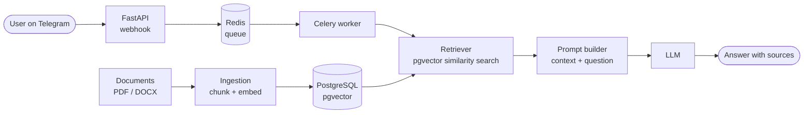

<!-- Animated hero. Upload hero.svg next to this README (same folder / repo root).
     One-file alternative (no extra upload): replace the line below with
      -->


<br/>

I turn raw data into models that run in production. My work centers on **retrieval-augmented generation, NLP and predictive modeling**, with a strong focus on evaluation and reliability.

<p>
<a href="https://linkedin.com/in/YOUR_USERNAME"></a>
<a href="https://kaggle.com/YOUR_USERNAME"></a>
<a href="https://huggingface.co/YOUR_USERNAME"></a>
<a href="mailto:you@example.com"></a>
</p>

<p align="center">
  <a href="#impact">Impact</a> &nbsp;·&nbsp;
  <a href="#architecture-in-practice">Architecture</a> &nbsp;·&nbsp;
  <a href="#how-i-build">Code</a> &nbsp;·&nbsp;
  <a href="#selected-work">Work</a> &nbsp;·&nbsp;
  <a href="#technical-stack">Stack</a> &nbsp;·&nbsp;
  <a href="#experience--credentials">Experience</a> &nbsp;·&nbsp;
  <a href="#contact">Contact</a>
</p>

<br/>

## Impact

<table align="center">
<tr>
<td align="center" width="25%"><h2>00+</h2><sub>ML projects delivered</sub></td>
<td align="center" width="25%"><h2>00K</h2><sub>documents processed</sub></td>
<td align="center" width="25%"><h2>00%</h2><sub>answer accuracy on eval set</sub></td>
<td align="center" width="25%"><h2>&lt; 0s</h2><sub>average response time</sub></td>
</tr>
</table>

<sub>Replace the zeros with your real numbers. Even two or three honest figures make a profile far more credible.</sub>

<br/>

## Architecture in practice

A production retrieval-augmented assistant I built and run, from message to grounded answer:



<br/>

## How I build

Clean, typed, testable code. A simplified view of the retrieval step:

```python
def answer(question: str, k: int = 5) -> Answer:
    """Embed the question, retrieve the closest chunks, answer only from them."""
    query_vec = embed(question)

    chunks = db.execute(
        "SELECT content, source FROM chunks ORDER BY embedding <=> %s LIMIT %s",
        (query_vec, k),
    ).fetchall()

    context = "\n\n".join(c.content for c in chunks)
    reply = llm.generate(PROMPT.format(context=context, question=question))

    return Answer(text=reply, sources=[c.source for c in chunks])
```

**Evaluation snapshot** &nbsp;<sub>(example format, put your own measured results)</sub>

| Metric | Result | How it is measured |
|:--|:--:|:--|
| Retrieval hit rate @5 | 00% | Relevant chunk present in top 5 results |
| Answer faithfulness | 00% | Claims supported by retrieved context |
| Refusal on out-of-scope questions | 00% | Declines instead of inventing an answer |
| p95 latency | 0.0 s | End to end, message to reply |

<br/>

## Selected work

| Project | What it does | Stack |
|:--|:--|:--|
| [**TeleDesk**](https://github.com/YOUR_USERNAME/teledesk) | Support assistant that answers customer questions from a company's own documents | FastAPI, PostgreSQL + pgvector, Celery, Redis, Gemini |
| [**Project Two**](https://github.com/YOUR_USERNAME/project-two) | Problem solved, approach, and the measured result | PyTorch, Transformers |
| [**Project Three**](https://github.com/YOUR_USERNAME/project-three) | Problem solved, approach, and the measured result | Pandas, scikit-learn, XGBoost |
| [**Project Four**](https://github.com/YOUR_USERNAME/project-four) | Problem solved, approach, and the measured result | TensorFlow, OpenCV |

<br/>

## Technical stack

<table>
<tr><td width="22%"><b>Languages</b></td><td>Python, SQL, R, JavaScript</td></tr>
<tr><td><b>Machine learning</b></td><td>PyTorch, TensorFlow, scikit-learn, XGBoost, Hugging Face Transformers</td></tr>
<tr><td><b>LLM systems</b></td><td>RAG, embeddings, vector search, prompt design, evaluation</td></tr>
<tr><td><b>Data</b></td><td>Pandas, NumPy, PostgreSQL, Redis, Power BI</td></tr>
<tr><td><b>Engineering</b></td><td>FastAPI, Celery, Docker, Git, Linux, CI/CD</td></tr>
</table>

<p>
<picture>
  <source media="(prefers-color-scheme: dark)" srcset="https://skillicons.dev/icons?i=python,pytorch,tensorflow,sklearn,pandas,numpy,fastapi,postgres,redis,docker,git,linux&perline=12&theme=dark">
  
</picture>
</p>

<br/>

## GitHub activity

<p>
<picture>
  <source media="(prefers-color-scheme: dark)" srcset="https://github-readme-stats.vercel.app/api?username=YOUR_USERNAME&show_icons=true&theme=dark&hide_border=true&bg_color=0d1117&count_private=true&include_all_commits=true">
  
</picture>
<picture>
  <source media="(prefers-color-scheme: dark)" srcset="https://github-readme-stats.vercel.app/api/top-langs/?username=YOUR_USERNAME&layout=compact&theme=dark&hide_border=true&bg_color=0d1117&langs_count=6">
  
</picture>
</p>

<br/>

## Experience & credentials

| Period | Role | Focus |
|:--|:--|:--|
| 2025 – Present | **Role title**, Company or Freelance | What you built and the measurable impact |
| 2023 – 2025 | **Role title**, Company | What you built and the measurable impact |
| 2019 – 2023 | **Degree**, University | Field of study, notable thesis or project |

**Certifications:** Machine Learning Specialization (DeepLearning.AI) · Data Science Professional Certificate · *add yours*

<br/>

## Contact

Open to freelance projects, collaborations and full-time roles.

<p>
  <a href="https://linkedin.com/in/YOUR_USERNAME"></a>
  <a href="https://t.me/YOUR_USERNAME"></a>
  <a href="mailto:you@example.com"></a>
</p>
