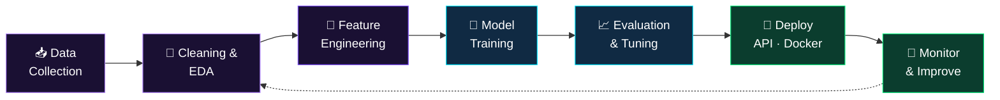

<!-- ============================================================
  AI / Data Science GitHub Profile README (design draft)
  Replace every YOUR_USERNAME / placeholder with your real info.
  Save as README.md inside a repo named exactly like your username.
============================================================ -->

<div align="center">


<a href="https://git.io/typing-svg">
  
</a>

<br/>


<br/><br/>

<a href="https://kaggle.com/YOUR_USERNAME"></a>
<a href="https://huggingface.co/YOUR_USERNAME"></a>
<a href="https://linkedin.com/in/YOUR_USERNAME"></a>
<a href="mailto:you@example.com"></a>

</div>

<br/>

## 🧠 `whoami`

```python
class DataScientist:
    name        = "Your Name"
    location    = "Egypt 🇪🇬"
    role        = "AI Engineer & Data Scientist"
    languages   = ["Python", "SQL", "Arabic", "English"]
    focus       = ["LLMs & RAG", "NLP", "Computer Vision", "Predictive Modeling"]
    philosophy  = "A model that never ships is just a notebook."
    fuel        = float("inf")  # coffee ☕

    def current_mission(self):
        return "Building AI assistants that answer from real company data"

    def open_to(self):
        return ["Freelance", "Collaborations", "Interesting problems"]
```

<br/>

## ⚙️ How I work — the pipeline



<br/>

## 🛠️ Arsenal

<div align="center">

| | |
|:---:|:---|
| **Languages** |  |
| **ML / Deep Learning** |  |
| **Data & Analysis** |  |
| **Backend & MLOps** |  |
| **Tools** |  |


</div>

<br/>

## 📡 Currently training

```text
Deep Learning ........ ████████░░  80%
LLMs / RAG ........... █████████░  90%
MLOps & Deployment ... ███████░░░  70%
Statistics ........... ████████░░  80%
System Design ........ █████░░░░░  50%
```

<br/>

## 🔬 Experiments & results

| 🧪 Project | 🎯 Task | 📏 Metric | 🧰 Stack |
|---|---|---|---|
| **[TeleDesk](https://github.com/YOUR_USERNAME/teledesk)** | RAG customer-support bot | Answers from company docs | FastAPI · pgvector · Celery · Gemini |
| **[Project Two](https://github.com/YOUR_USERNAME/project-two)** | Sentiment analysis (Arabic) | F1 = 0.00 | PyTorch · Transformers |
| **[Project Three](https://github.com/YOUR_USERNAME/project-three)** | Sales forecasting | RMSE = 0.00 | Pandas · XGBoost |
| **[Project Four](https://github.com/YOUR_USERNAME/project-four)** | Image classification | Accuracy = 00% | TensorFlow · OpenCV |

<br/>

## 🚀 Featured repositories

<div align="center">
<a href="https://github.com/YOUR_USERNAME/teledesk"></a>
<a href="https://github.com/YOUR_USERNAME/project-two"></a>
<br/>
<a href="https://github.com/YOUR_USERNAME/project-three"></a>
<a href="https://github.com/YOUR_USERNAME/project-four"></a>
</div>

<br/>

## 📊 GitHub analytics

<div align="center">


</div>

<br/>

## 💼 What I can build for you

| 🤖 Service | ✨ Outcome |
|---|---|
| **Custom AI Chatbots** | Telegram / WhatsApp / web bots trained on *your* documents |
| **RAG & Document Q&A** | Search and answer across PDFs, Word files and knowledge bases |
| **Predictive Models** | Forecasting, classification and recommendation systems |
| **Data Dashboards** | Clean, interactive insights from messy data |
| **AI Deployment** | Dockerized APIs, ready for production |

<br/>

## ✍️ Latest from my blog

<!-- BLOG-POST-LIST:START -->
- Coming soon...
<!-- BLOG-POST-LIST:END -->

<br/>

<div align="center">

### 📬 Let's build something intelligent

<a href="https://linkedin.com/in/YOUR_USERNAME"></a>
<a href="https://kaggle.com/YOUR_USERNAME"></a>
<a href="https://t.me/YOUR_USERNAME"></a>
<a href="https://wa.me/20XXXXXXXXXX"></a>
<a href="mailto:you@example.com"></a>

<br/><br/>

<sub><i>"Without data you're just another person with an opinion." — W. Edwards Deming</i></sub>


</div>
